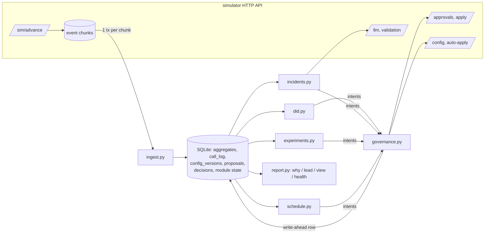

# Outcome-First Agent Loop — Submission

**Name:** _(fill in)_ · **Date:** 2026-11-06 · **Hours actually spent:** ~TBD · **Language / storage:** Python 3.11+ (httpx, numpy) / SQLite (WAL), no other services

---

## 0. TL;DR

- A single-process controller ingests every event exactly once into SQLite. Four policy modules (caller-ID health, hallucination incidents, welcome × voice experiments, call time) emit *intents*; one governance client turns them into auto-applies or batched approval requests, and never crosses the boundary.
- **public_01: +16.3% conclusions vs baseline (pickup +11.3%, engagement +3.1%); public_02: +31.3% (pickup +24.5%, engagement +3.3%)**, with **0 harmful changes** in both. The flagged caller ID is out of rotation the same day. The supervisor's bad prompt is reverted with validation evidence 3h after it shipped (1h45 to detect, 1h15 for the client to approve). The decaying welcome message is promoted, then rolled back by its holdout.
- Crash safety is demonstrated: 8 injected crash points (each right after an unrecorded side effect) plus random SIGKILLs. There are no double-applies, no lost approvals, and every event is counted exactly once (`reports/crash_test.log`).
- Load: TBD.
- **Cut:** per-person call time, cross-tenant fairness, a UI, and prompt optimisation. Prompts are only ever *reverted* to a known-good version for safety, never tuned.

## 1. Assumptions

1. `pickup_rate_max_drop: 0.02` / `engagement_rate_max_drop: 0.02` are **absolute** drops in the rate (2 percentage points). If they were relative, the guardrails would be about half as strict; nothing in my controller is close to either bound, but the check would change.
2. Welcome message and voice are heard *after* the call connects, so they cannot move pickup. Their experiments are judged on engagement. Pickup is guarded at workflow level, and only by the levers that can move it (caller ID, schedule).
3. Scenario end (`end_minute` from `/sim/state`) is used only to avoid starting an experiment that can't finish (≥3 days left). In production this becomes "don't start one you can't exploit".
4. Supervisors' edits are authoritative. After one, the controller doesn't propose on that dimension for 48h. The one exception is a safety incident caused by the edit itself, and that proposal says plainly that it reverts a supervisor change.
5. Tenant preferences stated in memos (Kestrel: ≤2 requests/day, none before 11:00) are honoured as **voluntary** limits on top of policy, and are kept in `controller/settings.py`.
6. History before D0 ran the business default config, so it carries no evidence about any variant other than the defaults. It is used for call-time profiles, flag-rate baselines and caller-ID usage, and never as experiment evidence.
7. Hidden scenarios share the API and schema. Feature values (languages, bands) are learned from `lead` events, not hard-coded.
8. Credits: incidents may use any credits; nothing else spends them. The actual spend was 2 credits per incident (one validation of the known-good prompt).

## 2. Scope decisions

| # | Capability | Built / Partial / Cut | Why | What it would take to finish |
|---|---|---|---|---|
| C1 | Event ingestion | **Built** | Everything depends on it; load scenario is the bar | Streaming parse + COPY into Postgres in prod |
| C2 | Shared cohort object | **Partial** | One partition per workflow (age × city tier) used by schedule, reports and experiments; experiments allocate at `default` so they never fragment traffic | Data-driven partition search; segment-level allocations (see §5) |
| C3 | Bootstrapping from history | **Built** (scoped) | Call-time model, flag-rate baseline, caller-ID usage; history has no variant evidence by construction | — |
| C4 | Call-time optimisation | **Partial: per cohort** | History gives an unconfounded hour profile per segment; per-person data is too thin (2–8 attempts per person, 20–40% returning) | Per-person shrinkage for returning people via `lead_preferred_hour` |
| C5 | Caller-ID health | **Built** | Biggest pickup lever, auto-appliable on 2/3 workflows, and an incident in public_02 | Re-probe of pulled numbers after a cool-off |
| C6 | W × V experiments | **Built** | The primary KPI on most workflows | Segment-level arms (load scale makes them detectable) |
| C7 | Promotion, decay, rollback | **Built** | Holdout-based; public_02's decaying W3 is caught | — |
| C8 | Hallucination response | **Built** | Graded MTTR; regulated clients | Engagement-aware choice among several validated fixes |
| C9 | Governance client | **Built** | Every change goes through it; most failure modes live here | Approver-latency learning per tenant |
| C10 | Impact, affected leads, dry run | **Built (honest, simple)** | A ranked queue needs a meaningful score | Proper off-policy replay with propensities |
| C11 | Supervisor view | **Partial: CLI/JSON** | One screen per workflow from the store | Minimal web page on top of `view --json` |
| C12 | Audit store | **Built** | Floor requirement; `why` and `lead` queries | — |
| C13 | Crash recovery | **Built + demonstrated** | SRE non-negotiable | — |
| C14 | Loop observability | **Partial** | Metrics table + `health` command + severities on alerts | Export to Prometheus; real paging |
| C15 | Fair allocation across tenants | **Cut** | Credits never came close to binding (2 of 200 used); approver attention is already per-workflow by policy | Per-tenant credit budgets + weighted queue |

**Principle.** Build the spine that every other capability depends on first, properly: ingestion, store, governance, crash safety. Then add the levers in order of (expected lift × how much the policy lets us use them) ÷ effort. In practice that meant caller IDs, then incidents, then experiments, then call time. Anything whose main value is presentation got the thinnest version that still answers the question.

## 3. Stakeholders

### 01 — Sales (Nikhil)
- **Accepted:** speed where it is free. Caller-ID and call-time changes auto-apply within policy on the same day. Every workflow gets its first experiment request in the first approver hour of D0.
- **Declined:** a single blended score (Product and the README both forbid blending pickup and engagement). Also "winning by lunch, live by evening": at ~1,000 connected calls a day, detecting a 10% engagement lift takes 2–3 days of traffic per arm, and a lunchtime "winner" is mostly noise (see §5 false-winner table). Also rolling out the persuasive prompt everywhere.
- **Wrong claims:** *"Kestrel has turned on auto-apply for everything."* No. `ks_cancel` auto-apply covers schedule, caller ID, welcome and voice with `max_shift: 0.2`. Prompt and cohort changes always need approval. *"Northwind said auto-apply on KYC is fine."* `nw_kyc` has auto-apply **disabled**. *"Persuasive prompt tested well."* It tested in another account, and evidence must come from this workflow. P4 is also the prompt most likely to hallucinate: its validation pass rate sits right at the 0.97 bar.
- **Reply:** "Nikhil — you'll get a per-client lift number, but two of them per client: pickup and engagement, never blended. They're what Product and our clients' compliance teams have signed up to. The fast changes (caller-ID rotation, call timing) already happen same-day without a human. Changes customers *hear* need a client approval on Northwind, and calling a winner at lunch is how you end up rolling back at dinner: at our volumes a real 10% lift takes 2–3 days to see. KYC isn't on auto-apply in the signed policy, and the persuasive script doesn't go anywhere without validation on that client's own workflow."

### 02 — Northwind Compliance (Meera)
- **Accepted (all five):** every customer-facing change (welcome, voice, script) on Northwind goes through named approval. Policy already forces this, and the controller marks those intents `auto: never` regardless. Script changes carry `evidence.validation_run_id`. The `lead` query answers "why did this customer hear this", down to the variant and the change that made it live (§10). Thresholds are conservative (P(best) ≥ 0.95, holdouts, rollbacks). Requests go out only in approver hours, and only when a decision can land before expiry.
- **Pushed back:** none on substance.
- **Wrong claim:** *"call timing and caller-ID rotation are covered by the policy we signed"* is true for renewal but **not for KYC**, where auto-apply is disabled. Those changes go to their approvers on KYC.
- **Reply:** "Meera — agreed on all five. Anything a customer hears on Northwind goes to your approvers with the evidence attached, and script changes carry a validation run. One correction: the signed KYC policy doesn't allow automatic timing or caller-ID changes, so on KYC those come to you as requests too (we batch them, one a day at most). For your auditors we can answer 'why did customer X hear Y on day D' from our own records, per call, within minutes, not 24 hours. The weekly summary lists every automatic change on Renewal with its reason."

### 03 — Platform/SRE (Kabir)
- **Accepted:** kill/restart is demonstrated, not promised (`scripts/crash_test.sh`). There are idempotency keys everywhere and every side effect is written ahead. There is no new stateful infrastructure: an embedded SQLite file, with a schema that ports to the Postgres he already runs. Loop health is available without reading logs (`controller health`, metrics table). Alerts carry a severity, and only `page` ones should page.
- **Pushed back:** the "<10 wall-minutes per load day" target bundles the simulator's own generation time, which we don't control. I report both separately (§8).
- **Reply:** "Kabir — kill/restart test is in the repo: 8 injected crash points right after unrecorded side effects, plus random SIGKILLs, with checks for double-apply, lost approvals and exactly-once ingestion. No new infra: state is one SQLite file per controller, same schema as Postgres if you'd rather host it. Load numbers and what breaks at 10× are in §8. Only `severity: page` alerts should wake you, and each one names the workflow and what to look at."

### 04 — Kestrel Ops supervisor (Anita)
- **Accepted:** her edits are never undone silently. A supervisor edit locks that dimension for 48h. The one exception was her P2 script, which tripled hallucination flags. It was reverted through an approval request that says *"reverses a supervisor change made at D3 11:30"*, with the evidence attached, so she sees it before it happens. At most 2 requests a day and none before 11:00 (voluntary, stricter than policy's 4 from 10:00), with incidents exempt from the 11:00 rule. Changes on a running campaign that customers hear go to her for approval even though policy would let us auto-apply them. One screen: `controller view --wf ks_cancel`. A "strict script" fix that kills engagement is caught: after any prompt fix the controller checks engagement against the pre-incident prompt, and it prefers prompts with production history over untested ones.
- **Pushed back:** caller-ID and call-time changes still auto-apply (policy allows it, nobody hears a difference). They show up in her view under "changed in the last 24h".
- **Reply:** "Anita — your edits stand. We don't touch a setting you've changed for two days unless it's causing a safety problem, and then we *ask* you, with the evidence. We'll send at most two requests a day, never before 11:00, and anything customers hear goes through you even though your policy would let us skip that. Caller-ID rotation and call timing still happen automatically; they're on your one screen with the reason. And we check engagement after any script fix, so a 'safe' script nobody stays on gets flagged."

### 05 — Product (Tara)
- **Accepted:** KPIs stay separate everywhere. One cohort partition per workflow, shared by schedule, view and reports. Minimum sizes are chosen and justified (§5), with the speed-vs-false-winner cost measured. Every proposal carries an impact score, a diff, an affected-lead count and a dry run, and the impact score has one definition across workflows. An expired proposal is treated as a rejection and re-proposed from fresh intents, never resubmitted. Evidence comes only from calls that actually ran with an arm (the call event's own `variant`), never from what a config said. Winners stay inside their workflow.
- **Pushed back:** per-person call time as the summit headline. The data per person is too thin, so cohort-level timing ships first. Caller-ID health and the supervisor view are P0 and are in. Per-person timing is the next thing after this submission.
- **Reply:** "Tara — all the definitions are held as written; the dry run and impact score are documented in the submission so you can check they mean something. Minimum cohort size is a function of traffic, not a constant: an arm needs ~300 connected calls before any decision, which is why experiments run at workflow level and segments only become testable at load-scale volumes. Per-person timing I've deliberately left out: most people get 2–8 attempts in their life with us, which is too little to learn their hour. Cohort timing is in; per-person is next, starting with returning leads."

### 06 — CTO (Aryamann)
- **Accepted:** explainability over size (every change has a rationale and a dry run, and the `why` query works live). Hurting a cohort is worse than nothing (holdouts, rollbacks, conservative thresholds, 0 harmful changes on the public scenarios). No compute where it doesn't change a decision: no LLM call when a known-good prompt exists, 2 credits per incident. Choose, and write down who was told no.
- **Reply:** "Aryamann — I built five things properly rather than fifteen: the governance/ingestion/crash-safety spine, caller-ID health, incident response, experiments with decay rollback, and cohort call-time. I said no to blended scores, auto-promoting winners, per-person timing for now, and cross-tenant fairness. The memos had three factual errors against the enforced policies (§3); the controller follows the policies. What breaks first at 10× is in §8."

## 4. Architecture



- **Loop** (`loop.py`): advance (15 min while anything can happen, otherwise jump to the next active hour) → ingest new chunks → for each workflow: reconcile proposals with the simulator, collect intents from the modules, hand them to governance.
- **State:** everything lives in one SQLite file (WAL). Aggregates: pickup by (day, hour, atom, caller ID); engagement by (day, hour, atom, welcome, voice, prompt); QA by (day, hour, prompt); a per-call log for audit. Module state is JSON per (module, workflow). Proposals and decisions are append-mostly.
- **On restart:** open the DB; ingest every chunk the simulator has that the `chunks` table doesn't; reconcile every in-flight proposal against `GET /approvals` (for approvals) or config history (for auto-applies); then decide at the current minute. A fresh simulator world (new scenario, or time went backwards) archives the old DB and starts clean.

## 5. The learning loop

**Cohorts.** One partition per workflow, age band × city tier. Segments with <3% of leads fold into `default`, giving at most 12 cohorts. It is used for call timing and reporting. Experiments allocate at `default`, which every cohort inherits, so cohorts never split experiment traffic. **Minimum size** is about evidence, not leads. An arm needs ≥300 connected calls before any decision, and a two-proportion test needs ~1,300 per arm to see a 10% lift at 80% power. At dev volumes (~1,000 connects/day per workflow) only workflow-level effects are detectable within a run. At load volumes (~15k/day) a segment of ~7% of leads becomes testable in about 3 days. The cost: effects confined to a small segment (e.g. V3 for the 60+ age band) are invisible at dev scale. I accept that rather than hand out false winners.

**Experiment design.** Factorial: welcome and voice are randomised independently per dial, so one allocation tests both, and each comparison uses all traffic. Interactions in the data so far are multiplicative, so main effects are what's needed. Exploration keeps ≥50% on the incumbent with ≤25% per challenger. That bounds what an unknown bad arm can cost while it's being found out. All exploration and promotion goes to a human, even where policy would allow auto-apply. Only calls that actually ran with an arm count, and only from when the allocation went live.

**Deciding a winner.** Beta(1,1)–Binomial posterior per arm on engaged/connected. Promote when P(best) ≥ 0.95 *and* P(beats incumbent) ≥ 0.975 *and* every arm has ≥300 connects *and* the last 24h still agree (P(beats) ≥ 0.6 on the recent window), so a winner that is already fading isn't promoted. P(best) over all arms is the multiple-comparison control: one decision per dimension, not one test per arm. Arms with P(beats incumbent) ≤ 0.025, overall or on the trailing 36h, are dropped. If nothing reaches the bar in 4 days, traffic settles in proportion to P(best) among arms more likely than not to beat the incumbent. No winner is declared then, and nothing is reverted to an option the data says is worse. Posterior draws are seeded from a hash of the counts, so decisions are deterministic and replayable.

**False-winner rate and power** (`scripts/false_winner.py`: Monte Carlo of the same rule, 200 runs per case, 1,000 connected calls/day, looked at every dialling hour):

| case | promoted a non-best arm | promoted the best arm | median days to promotion |
|---|---|---|---|
| A/A, 3 arms | 7.0% | — | — |
| A/A, 4 arms | 3.0% | — | — |
| one arm +10%, 3 arms | 0.0% | 79.5% | 1.8 |
| one arm +15%, 3 arms | 0.0% | 100% | 1.3 |
| one arm +15%, 4 arms | 0.0% | 88.5% | 2.1 |
| one arm −10%, 2 arms | 0.0% | — | — |

The cost of looking every hour is a 3–7% chance of promoting an arm that is *equal* to the incumbent. That is harmless to the KPI but costs an approval and a supervisor's attention. In these simulations no run promoted a *worse* arm. A bar of P(best) ≥ 0.97 would roughly halve the false-winner rate at the cost of about half a day of speed. I kept 0.95 because the holdout catches a promoted arm that turns out worse.

**Decay and rollback.** Promotion keeps 15% on the previous option as a holdout. Every tick, the trailing 36h of winner vs holdout is checked; P(winner worse) ≥ 0.9 triggers an urgent rollback, which auto-applies in max_shift steps where policy allows and otherwise uses the reserved approval slot. In public_02, W3 (+18%, fading to −10% over two days from D2) was promoted on D1. Decay was suspected D5 09:00 and confirmed D5 15:00. The first rollback request went stale on a supervisor's voice edit, and the re-proposal was applied D6 10:15. The grader shows its share in the affected population at 0.85 through D5, 0.09 on D6 and 0 after. Detection takes ~2.5 days from onset because the fade is gradual and the 36h window has to fill with post-decay calls. That is the price of not rolling back real winners on noise (a single look at P=0.9 did exactly that in an earlier version).

**Call time and caller ID.** Call time: history ran a flat schedule, so pickup by (segment, hour) there is unconfounded. Each cohort's hour weight is its comparative advantage (pickup in h ÷ its own daily mean)^γ, with cells shrunk toward a segment × hour product model and every hour kept above 0.2 so no capacity is wasted. γ ∈ {1,2,3} is picked by an IPF dry run that keeps hourly capacity and per-cohort attempts fixed. Predicted lift is +1.6–2.2% pickup. Per-person timing was cut (§2). Caller ID: per-dial randomisation makes "this number vs the other numbers in the same hours" a clean test. A number is pulled when its ratio is <0.5, z < −4, *and* it's a change from its own previous 12h. Untested numbers are probed at 5% (one at a time where auto-apply allows). Healthy numbers share traffic ∝ (measured health)², shrunk by significance, at most every 6h. This captures that busy numbers pick up worse: it was the largest single lever (e.g. nw_kyc went from one number to three).

**Guardrail KPI.** The levers are split by which KPI they can move. W/V can't change pickup, so for engagement-primary workflows the pickup guardrail is threatened only by caller ID and schedule, and both are chosen to *raise* pickup. For nw_kyc (pickup primary), W/V experiments are the engagement guardrail's own lever, and they are only promoted on engagement gains. Workflow-level pickup and engagement are visible day-on-day in the view, and every `why` answer shows 24h before/after.

## 6. Governance

**State machine:**
```
submitting ─POST ok→ pending ─→ approved ─apply ok→ applied
    │                   │          ├─409 stale→ stale     → intents re-proposed on the new base next slot
    │                   │          ├─410──────→ lapsed    → re-proposed
    │                   │          └─urgent in flight→ deferred (left to lapse; re-proposed after)
    │                   ├─→ rejected → intents come back next slot with fresh data
    │                   └─→ expired  → treated as rejection; never resubmitted as-is
    ├─4xx→ refused (alert)
    └─crash→ reconciled on restart (found in /approvals → adopt; not found → abandoned)
auto: submitting → applied | refused (reconciled from config history after a crash)
```

**Batching and timing.** At most one non-urgent approval in flight per workflow. Everything the modules want that needs a human goes into it. The quota is `min(policy, tenant preference)` per 24h with one slot reserved for incidents, and requests are spaced ≥3h apart. A request is only sent inside approver hours, and only if its decision can land before expiry (same-day, or next-day opening within the TTL), so nothing sits in a night queue. Approved changes are applied on the next tick (15 min), well inside the 2h apply window.

**Auto-apply vs voluntary restraint.** Auto-apply is used for caller ID and schedule where policy allows. It is never used for anything a customer hears, except rollbacks (risk-reducing; stepped within `max_shift`). Promotions are never chained in max_shift-sized steps to get around the limit. Auto-applies are frozen while an approval is in flight, because any version bump would make it stale. Safety moves (pulling a degraded number) ignore the freeze and accept the re-proposal cost.

**Impact score, affected leads, dry run.** Impact score = 1 − exp(−x / (2% of the daily batch)), where x = expected extra concluded leads per day. A change worth 2% of a day's leads scores 0.63 and one worth 5% scores 0.92, on every workflow, so a queue ranked by it is ranked by expected outcome. Exploration has expected value ≈ 0 and scores ≈ 0: its value is information, and the rationale says so. Incidents are floored at 0.9. Affected leads: active (uploaded within the cadence, not concluded) for mid-flight changes, the next batch for `next_campaign_only`. Dry runs: experiments use posterior means of arms *that ran* replayed over the last 3 days' connected volume (arms with no evidence are shown as such, assumed equal to the incumbent). Caller ID uses hour-matched health × the new allocation. Schedule uses the IPF redistribution of history. Prompt changes use production flag rates plus the validation run. These are honest about what they are: model-based estimates, not off-policy replays with propensities.

**Supervisor edits mid-experiment.** The edit is recorded as a decision. That dimension's experiment stops ("their choice stands"), its data is kept, and no proposals touch the dimension for 48h. Any in-flight approval that the edit made stale is detected on apply (409) and re-proposed from fresh intents on the new base. In public_02, the nw_renewal voice change at D5 15:00 stopped the voice experiment, and the 48h lock ran past the point where a new one could finish, so it was left alone.

## 7. Incidents

**Detection.** Hallucination flags on the *current* prompt over 1h, 3h and 12h windows vs the workflow's historical flag rate (which includes the detector's ~1% false-positive floor). Fire when flags ≥ 8, ≥2× normal and Poisson tail p < 1e-4. For 24h after any prompt change the bar is ≥6 flags and p < 1e-3, because that's where regressions come from. Expected false positives: per check, ≤1e-4 (≤1e-3 after a change). With ~150 correlated checks per workflow-day, that is well under one false incident per workflow-month outside change windows.

**Fix.** Cheapest first: a prompt with production history on this workflow and a normal flag rate (usually the one before the incident) → validate it (n=200, 2 credits) → propose as urgent with `evidence.validation_run_id`. Only if no such prompt exists, ask the LLM (3 credits) and validate its suggestions in turn. After apply, verify flags return to normal on ≥150 connects and engagement isn't significantly down vs the reference prompt; otherwise page.

**public_02 timeline (ks_cancel), from `controller why`:**

| time | event |
|---|---|
| D3 11:30 | supervisor ships P2 (actor `supervisor`, v9). Recorded; prompt dimension locked for proposals; lower detection bar armed for 24h |
| D3 13:15 | incident opened: 11 flags in 202 connected calls over 3h (5.4% vs normal 1.4%, p=1.4e-4) |
| D3 13:15 | known-good candidate P1 (20,399 production calls at 1.3% flags) validated: pass 0.985, n=200, **2 credits**; no LLM call needed |
| D3 13:15 | urgent approval `apr_00010` requested: "Revert prompt P2 → P1 … (reverses a supervisor change made at D3 11:30)", evidence attached |
| D3 14:04 | client approver approves |
| D3 14:30 | applied (next tick); **MTTR 180 min** per the grader |
| D3 16:00 | verified: flags on P1 at 2.0% on ≥150 connects, engagement not down → resolved |

The caller-ID incident in the same scenario (D2 flagged at D2 10:00, health 0.35): pulled within the day, and the flagged number carried 5.5% of D2's dials and 0% thereafter (grader `flagged_did_share_by_day`).

## 8. Scale

TBD.

## 9. Reliability

- **Method** (`scripts/crash_test.sh`, log in `reports/crash_test.log`): `CONTROLLER_CRASHPOINTS` makes the process `os._exit` (no cleanup, like SIGKILL) at 8 points: mid-ingest before commit; after an auto-apply PUT, before an approval POST and after it; after an apply POST (several of them on later occurrences). Then 4 random SIGKILLs. Then run to completion and verify against the simulator: no approval or auto-apply applied twice, every simulator approval known to the store with the same status, nothing lapsed unintentionally, every chunk ingested once, and aggregate dial counts equal to the raw call events. **All checks pass.**
- **State lost on crash:** at most the in-progress tick's decisions that hadn't been written. They are recomputed identically, because modules are functions of the store and proposal ids are deterministic (`{wf}-{kind}-{minute}-v{base}-{config hash}`).
- **Idempotency keys:** chunk number (ingestion), `proposal_id` (approvals and auto-applies, written before the call), `approval_id` status guard (apply), `event_id` (call log, sim events).
- **4xx/5xx:** transport errors and 5xx retry with exponential backoff (all calls are reads or carry their own idempotency key). 4xx are returned as values: 409 stale → `stale` and re-propose; 410 → `lapsed`; 403 auto-apply → recorded, intent falls to the approval path; 402 credits → page; any unexpected 4xx → `alert`.

## 10. Audit & observability

Full outputs are in `reports/audit_examples.md`. The queries read only the controller's SQLite file.

```
$ python -m controller why --wf nw_renewal --at 'D6 10:15' --db state/public_02_incidents.db
## v11 at D6 10:15 — controller_approved, changed welcome_message
**Proposal** `nw_renewal-urgent-8295-v10-197fe3be` requested D5 18:15, approval `apr_00014` approved by the
client approver at 10:00, applied D6 10:15.
- Summary: Set welcome_message back to W1 (promoted option faded)
- Impact score 0.99, affected leads 2241
- Diff: {"allocations.default.welcome_message": {"from": {"W1": 0.15, "W3": 0.85}, "to": {"W1": 1.0}}}
- Dry run: posterior mean engagement per arm from calls that actually ran with it ... W1 0.591 (n=257),
  W3 0.478 (n=1378, lift -19% [-28%, -9%]) -> +102 conclusions/day
**Decision trail for exp-nw_renewal-welcome_message-1:**
- D0 00:00 experiment_planned: test W2, W3 against W1 on welcome_message
- D0 11:15 experiment_live: explore allocation live: {'W1': 0.5, 'W2': 0.25, 'W3': 0.25}
- D1 14:15 experiment_winner: W3 beats W1 on engagement (P(best)=0.965, lift +15.5% [+3.8%, +28.2%], n=319);
  promote with 15% holdout on W1
- D1 18:15 experiment_live: exploit allocation live: {'W1': 0.15, 'W3': 0.85}
- D5 09:00 experiment_decay_suspected: W3 -18.5% vs holdout W1 over the last 36h (P(worse)=0.99); confirming
- D5 15:00 experiment_decay: W3 has stopped winning: -19.2% vs holdout W1 (P(worse)=1.00); rolling back to W1
- D6 10:15 experiment_settled: welcome_message settled on {'W1': 1.0}
**What happened next** (24h before -> 24h after): pickup 0.29 -> 0.301, engagement 0.496 -> 0.56
```

`python -m controller lead --lead <lead_id>` answers the compliance question ("why did this customer hear this"). It lists every call to the lead with the exact variant, cohort and config version. Then, for each dimension, it names the change that last set it: actor, approval id and the summary the approver saw. Example in `reports/audit_examples.md`: a ks_cancel lead that heard the supervisor's P2 script at D3 11:52, with the incident revert that replaced it.

`python -m controller view [--wf X] [--json]` is the supervisor's one screen: today vs yesterday on both KPIs, what's being tested and who's leading, caller-ID status, open incident, requests waiting on them (ranked by impact), changes in the last 24h, and alerts. `python -m controller health` shows the loop itself: ingest throughput, ingest/decide time per sim day, peak decide time per tick, RSS, credit burn, decision counts, recent alerts.

**Alerts.** Page: a module crashed (workflow left unchanged); an apply failed unexpectedly; no validated fix exists for an open incident; a fix didn't bring flags down; out of credits. Ticket (business hours): auto-apply refused; approval request refused; a safe fix that lowered engagement. Don't alert: rejections, expiries, stale bases (normal governance; visible in the view), probes and rebalances. Each alert names the workflow and the decision row to look at; none fired on the public scenarios.

## 11. Results

**public_01** (`reports/public_01_dev.md`):

| workflow | conclusion rate | Δ | pickup | Δ | engagement | Δ | gap captured |
|---|---|---|---|---|---|---|---|
| ks_cancel | 0.375 | +12.7% | 0.260 | +9.2% | 0.500 | +1.8% | 9% |
| nw_kyc | 0.486 | +33.8% | 0.298 | +23.1% | 0.624 | +5.7% | 28% |
| nw_renewal | 0.464 | +10.5% | 0.284 | +7.9% | 0.557 | +2.1% | 14% |
| **ALL** | **0.428** | **+16.3%** | 0.276 | +11.3% | 0.546 | +3.1% | 16% |

19 changes applied: 9 beneficial, 10 neutral, **0 harmful**. Governance: 13 requests, 11 approved, 2 judgement-call rejections, 0 expired, 0 lapsed, 1 stale (a caller-ID safety pull landed while a request was pending; re-proposed next morning). Credits used: 0.

**public_02** (`reports/public_02_incidents.md`):

| workflow | conclusion rate | Δ | pickup | Δ | engagement | Δ | gap captured | hallucinated calls (base) |
|---|---|---|---|---|---|---|---|---|
| ks_cancel | 0.386 | +55.8% | 0.254 | +38.1% | 0.518 | +8.8% | 50% | 76 (330) |
| nw_kyc | 0.489 | +30.5% | 0.303 | +25.2% | 0.604 | +2.0% | −13% | 47 (31) |
| nw_renewal | 0.479 | +12.3% | 0.292 | +11.4% | 0.548 | +0.1% | 14% | 77 (55) |
| **ALL** | **0.439** | **+31.3%** | 0.276 | +24.5% | 0.547 | +3.3% | 31% | 200 (416) |

21 changes applied: 13 beneficial, 8 neutral, **0 harmful**. Prompt incident MTTR 180 min (fixed by an approved controller change). Flagged caller ID: 5.5% of the flag day's dials, 0% after. Decaying W3: 85% of its population through D5 (decay began D2), 8.6% on D6 when the rollback landed, 0% after. Governance: 14 requests, 13 approved, 1 rejected, 0 expired, 0 lapsed, 1 stale (the supervisor's mid-experiment voice edit). Credits: 2.

**Interpretation.**
- **Where the lift comes from:** mostly pickup, via caller-ID load spreading and probing. nw_kyc dialled everything from one number, so it gains the most (+23–25% pickup). Pickup lifts the business outcome directly, because more connects means more conclusions within the same cadence. Hallucinated *calls* rise slightly where pickup rose (more connects), not per connect.
- **Engagement:** captured 14–50% of the hidden headroom. ks_cancel does best (V4/W2 winners). nw_renewal is weakest: its real effects are segment-specific (V3 for 60+, V2 for Tamil speakers, W2 for Hindi speakers) and invisible at workflow level at dev volumes. That's the cost of not doing segment arms (§13).
- **nw_kyc "gap captured −13%" on public_02:** the grader computes this on connected calls. The welcome test carried 25% on W2, which is truly −8% and was dropped by the controller, but on `next_campaign_only` the campaigns created while it was live keep their allocation for their whole 3-day cadence. Engagement on nw_kyc still ended +2.0% because the V2 promotion outweighed it. Exploration is never free; on locked-campaign workflows it is paid for longer.
- **What I'd change:** segment-level arms where volume supports them (load-scale workflows would capture far more of the headroom), and a slightly stricter promotion bar on 2-arm dimensions of `next_campaign_only` workflows, where mistakes are locked in for days.

## 12. Trade-offs & rejected alternatives

| Option | Why considered | Why rejected / what instead |
|---|---|---|
| Thompson sampling with continuous re-allocation | Faster regret | Every re-allocation is an approval on Northwind; fixed allocations per approval + Bayesian stopping |
| Frequentist sequential test (alpha spending) | Classic, auditors know it | Posterior statements ("P it's best") read better to a supervisor; peeking handled by conservative bars + measured false-winner rate |
| Promote winners to 100% | Captures the full lift | No way to see decay; 15% holdout costs ~2% of the lift and buys rollback |
| Per-person call time | Product headline | Too few observations per person; cohort timing ships first |
| `lead_preferred_hour` per person from feature model, auto-applied | Avoids needing cohort approval | Same information as cohort weights, a 6MB config at load scale every day, and invisible to a supervisor |
| Chaining auto-applies in max_shift steps for promotions | Faster on Kestrel | Defeats the intent of max_shift; only risk-reducing moves are stepped |
| LLM first for every incident | Matches the C8 sketch | Spends credits where a known-good revert is the obvious, better-evidenced fix |
| Postgres / Redis | SRE already runs them | Embedded SQLite keeps `run.sh` dependency-free; schema is portable |
| Store raw events | Full replay | Aggregates + compact call log are enough for every question asked; ~10× smaller |

## 13. Known weaknesses

1. **No segment-level experiments.** Effects that live in one age band or language are averaged away at workflow level. The cohort partition (age × tier) can't express language segments at all without re-partitioning, which needs an approval and touches the schedule.
2. **Mild decays go unnoticed in short runs.** public_01's W3 decays from 1.15 to 0.93 (a −19% swing vs holdout, but only −7% vs W1). With a 15% holdout and 6-hourly checks needing two confirmations, the run ended before it was rolled back. The holdout share and check cadence trade false rollbacks (which I saw at P=0.9 with single looks) against speed.
3. **Call-time weights are fitted once, from history.** The model doesn't learn from post-change data, and there is no holdout to measure the schedule's own lift; the +1.6–2.7% figure is a prediction, not a measurement.
4. **Caller-ID "degraded" is permanent for the run.** No re-probe after a cool-off, and the fatigue-vs-flag distinction (a change against the number's own previous 12h) is a heuristic.
5. **Exploration is judged harmful by expected value at apply time in principle.** I bounded it (≤25% per challenger, ≥50% incumbent) and saw 0 harmful in the final runs, but a hidden scenario with several bad challengers on a 2-option dimension could still trip it.
6. **One process, one SQLite writer.** Fine at public_03 scale; partitioning is in §8.
7. **The per-call audit log is large** (≈130 bytes/call; ~740 MB for public_03's 5 days + history). In production it belongs in columnar cold storage with a retention policy.
8. **Thresholds were tuned on the public scenarios** (e.g. the incident p-values, the decay confirmations). Each change is justified statistically in the code comments, but the hidden scenarios are the real test.

## 14. If this went to production at Formi next month

1. **Shadow mode first (days 1–3).** Run the controller against live events with governance in "propose to a log, never send" mode on two workflows. Compare its decisions with what supervisors did, and calibrate the false-incident and false-winner rates on real traffic.
2. **Move the store to the existing Postgres (days 2–4).** Same schema. Aggregates partitioned by day; `call_log` to cold storage with a retention policy agreed with Compliance (IRDAI audit window).
3. **Paging wired to the alert severities (day 4).** Plus a dashboard on the metrics table: ingest lag, decide time, credits, and requests per workflow per day vs quota.
4. **Turn on caller-ID health and incident response for real (week 2).** They are the safest, highest-value levers, and the most mechanical to verify.
5. **Experiments on one consenting tenant (week 2).** Weekly summary to their Compliance head generated from `view --json`.
6. **Then:** segment-level arms where volume allows, call-time learning from live data with a person-level holdout, and per-person timing for returning leads.
