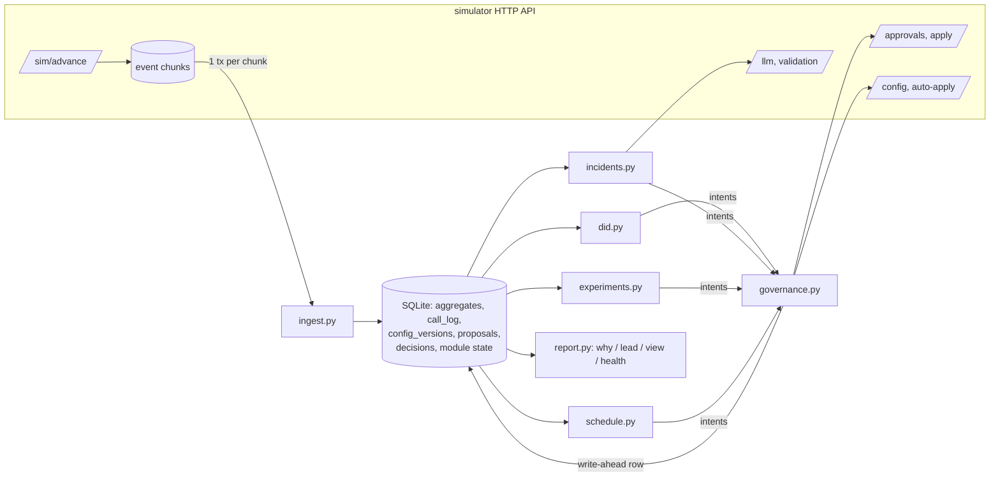

# Outcome-First Agent Loop — Submission

**Name:** Sri Pranav Tene · **Date:** 2026-11-09 · **Hours actually spent:** ~8 h across several iterations, AI-assisted with Claude Code (6–9 Nov) · **Language / storage:** Python 3.11+ (httpx, numpy) / SQLite (WAL), no other services

---

## 0. TL;DR

- A single-process controller ingests every event exactly once into SQLite. Four policy modules (caller-ID health, hallucination incidents, welcome × voice experiments, call time) emit *intents*; one governance client turns them into auto-applies or batched approval requests, and never crosses the boundary.
- **Judged on seed sweeps, not single runs** (`scripts/sweep.py`: each scenario × 5 seeds). **public_01: +15.0% ± 2.1% conclusions vs baseline; public_02: +28.7% ± 1.5%; 0 harmful changes in all 10 public runs.** The canonical single runs: public_01 +15.0%, public_02 +31.0%. The flagged caller ID is out of rotation the same day. The supervisor's bad prompt fails our validation 15 minutes after it ships and is reverted through an approval with that evidence (**MTTR 90 min**, mostly approver latency). The decaying welcome message is promoted, then rolled back by its holdout.
- **Hidden-like variants** I built to test on truth the controller was never tuned on (`tests/scenarios/`): **+20.8% ± 2.2% and +32.3% ± 2.2%** over 5 seeds. Variants and sweeps found six bugs, all fixed with a test each (§11). Most remaining "harmful" verdicts are the measured cost of exploring (a smaller share was tried and is worse) and a safety revert I'd make again.
- Crash safety is demonstrated in two passes on public_02: 6 injected crashes, each right after a side effect the store hasn't recorded yet, then 6 random SIGKILLs on a fresh run. There are no double-applies, no lost approvals, and every event is counted exactly once (`reports/crash_test.log`).
- **Load (public_03, 12 workflows, ~650k dials/day): +21.0% conclusions, 0 harmful of 66 changes.** The controller spends ~40 s of CPU per simulated day (ingest + decide; 82 s on a busier machine earlier) and 64 s wall per simulated day including the simulator's own generation. Peak RSS is 467 MB.
- **Cut:** per-person call time, cross-tenant fairness, a UI, and prompt optimisation. Prompts are only ever *reverted* to a known-good version for safety, never tuned.

## 1. Assumptions

1. `pickup_rate_max_drop: 0.02` / `engagement_rate_max_drop: 0.02` are **absolute** drops in the rate (2 percentage points). If they were relative, the guardrails would be about half as strict; nothing in my controller is close to either bound, but the check would change.
2. Welcome message and voice are heard *after* the call connects, so they cannot move pickup. Their experiments are judged on engagement. Pickup is guarded at workflow level, and only by the levers that can move it (caller ID, schedule).
3. Scenario end (`end_minute` from `/sim/state`) is used only to avoid starting an experiment that can't finish (≥3 days left). In production this becomes "don't start one you can't exploit".
4. Supervisors' edits are authoritative. After one, the controller doesn't propose on that dimension for 48h. The one exception is a safety incident caused by the edit itself, and that proposal says plainly that it reverts a supervisor change.
5. Tenant preferences stated in memos (Kestrel: ≤2 requests/day, none before 11:00) are honoured as **voluntary** limits on top of policy, and are kept in `controller/settings.py`.
6. History before D0 ran the business default config, so it carries no evidence about any variant other than the defaults. It is used for call-time profiles, flag-rate baselines and caller-ID usage, and never as experiment evidence.
7. Hidden scenarios share the API and schema. Feature values (languages, bands) are learned from `lead` events, not hard-coded.
8. Credits: only incident response spends them. That covers validating a supervisor's prompt edit when it is seen (2), validating the fix (2), and an LLM call only if no known-good prompt exists (3). public_02 used 4 of 200.

## 2. Scope decisions

| # | Capability | Built / Partial / Cut | Why | What it would take to finish |
|---|---|---|---|---|
| C1 | Event ingestion | **Built** | Everything depends on it; load scenario is the bar | Streaming parse + COPY into Postgres in prod |
| C2 | Shared cohort object | **Partial** | One partition per workflow (age × city tier) used by schedule, reports and experiments; experiments allocate at `default` so they never fragment traffic | Data-driven partition search; segment-level allocations (see §5) |
| C3 | Bootstrapping from history | **Built** (scoped) | Call-time model, flag-rate baseline, caller-ID usage; history has no variant evidence by construction | — |
| C4 | Call-time optimisation | **Partial: per cohort** | History gives an unconfounded hour profile per segment; per-person data is too thin (2–8 attempts per person, 20–40% returning) | Per-person shrinkage for returning people via `lead_preferred_hour` |
| C5 | Caller-ID health | **Built** | Biggest pickup lever, auto-appliable on 2/3 workflows, and an incident in public_02 | Re-probe of pulled numbers after a cool-off |
| C6 | W × V experiments | **Built** | The primary KPI on most workflows | Segment-level arms (load scale makes them detectable) |
| C7 | Promotion, decay, rollback | **Built** | Holdout-based; public_02's decaying W3 is caught | — |
| C8 | Hallucination response | **Built** | Graded MTTR; regulated clients | Engagement-aware choice among several validated fixes |
| C9 | Governance client | **Built** | Every change goes through it; most failure modes live here | Approver-latency learning per tenant |
| C10 | Impact, affected leads, dry run | **Built (honest, simple)** | A ranked queue needs a meaningful score | Proper off-policy replay with propensities |
| C11 | Supervisor view | **Partial: CLI/JSON** | One screen per workflow from the store | Minimal web page on top of `view --json` |
| C12 | Audit store | **Built** | Floor requirement; `why` and `lead` queries | — |
| C13 | Crash recovery | **Built + demonstrated** | SRE non-negotiable | — |
| C14 | Loop observability | **Partial** | Metrics table + `health` command + severities on alerts | Export to Prometheus; real paging |
| C15 | Fair allocation across tenants | **Cut** | Credits never came close to binding (4 of 200 used on public_02, 0 of 400 on load); approver attention is already per-workflow by policy | Per-tenant credit budgets + weighted queue |

**Principle.** Build the spine that every other capability depends on first, properly: ingestion, store, governance, crash safety. Then add the levers in order of (expected lift × how much the policy lets us use them) ÷ effort. In practice that meant caller IDs, then incidents, then experiments, then call time. Anything whose main value is presentation got the thinnest version that still answers the question.

## 3. Stakeholders

### 01 — Sales (Nikhil)
- **Accepted:** speed where it is free. Caller-ID and call-time changes auto-apply within policy on the same day. Every workflow gets its first experiment request in the first approver hour of D0.
- **Declined:** a single blended score (Product and the README both forbid blending pickup and engagement). Also "winning by lunch, live by evening": at ~1,000 connected calls a day, detecting a 10% engagement lift takes 2–3 days of traffic per arm, and a lunchtime "winner" is mostly noise (see §5 false-winner table). Also rolling out the persuasive prompt everywhere.
- **Wrong claims:** *"Kestrel has turned on auto-apply for everything."* No. `ks_cancel` auto-apply covers schedule, caller ID, welcome and voice with `max_shift: 0.2`. Prompt and cohort changes always need approval. *"Northwind said auto-apply on KYC is fine."* `nw_kyc` has auto-apply **disabled**. *"Persuasive prompt tested well."* It tested in another account, and evidence must come from this workflow. P4 is also the prompt most likely to hallucinate: its validation pass rate sits right at the 0.97 bar.
- **Reply:** "Nikhil — you'll get a per-client lift number, but two of them per client: pickup and engagement, never blended. They're what Product and our clients' compliance teams have signed up to. The fast changes (caller-ID rotation, call timing) already happen same-day without a human. Changes customers *hear* need a client approval on Northwind, and calling a winner at lunch is how you end up rolling back at dinner: at our volumes a real 10% lift takes 2–3 days to see. KYC isn't on auto-apply in the signed policy, and the persuasive script doesn't go anywhere without validation on that client's own workflow."

### 02 — Northwind Compliance (Meera)
- **Accepted (all five):** every customer-facing change (welcome, voice, script) on Northwind goes through named approval. Policy already forces this, and the controller marks those intents `auto: never` regardless. Script changes carry `evidence.validation_run_id`. The `lead` query answers "why did this customer hear this", down to the variant and the change that made it live (§10). Thresholds are conservative (P(best) ≥ 0.95, holdouts, rollbacks). Requests go out only in approver hours, and only when a decision can land before expiry.
- **Pushed back:** none on substance.
- **Wrong claim:** *"call timing and caller-ID rotation are covered by the policy we signed"* is true for renewal but **not for KYC**, where auto-apply is disabled. Those changes go to their approvers on KYC.
- **Reply:** "Meera — agreed on all five. Anything a customer hears on Northwind goes to your approvers with the evidence attached, and script changes carry a validation run. One correction: the signed KYC policy doesn't allow automatic timing or caller-ID changes, so on KYC those come to you as requests too (we batch them, one a day at most). For your auditors we can answer 'why did customer X hear Y on day D' from our own records, per call, within minutes, not 24 hours. The weekly summary lists every automatic change on Renewal with its reason."

### 03 — Platform/SRE (Kabir)
- **Accepted:** kill/restart is demonstrated, not promised (`scripts/crash_test.sh`). There are idempotency keys everywhere and every side effect is written ahead. There is no new stateful infrastructure: an embedded SQLite file, with a schema that ports to the Postgres he already runs. Loop health is available without reading logs (`controller health`, metrics table). Alerts carry a severity, and only `page` ones should page.
- **Pushed back:** the "<10 wall-minutes per load day" target bundles the simulator's own generation time, which we don't control. I report both separately (§8).
- **Reply:** "Kabir — kill/restart test is in the repo: injected crashes right after unrecorded side effects, plus random SIGKILLs, with checks for double-apply, lost approvals and exactly-once ingestion. No new infra: state is one SQLite file per controller, same schema as Postgres if you'd rather host it. On the load scenario a simulated day takes 64–216 s wall including the simulator, depending on the box (40–82 s of it is us), at ~470 MB. First to break at 10× is the in-memory feature-join map, then decide time; both fixes are in §8. Only `severity: page` alerts should wake you, and each one names the workflow and what to look at."

### 04 — Kestrel Ops supervisor (Anita)
- **Accepted:** her edits are never undone silently. A supervisor edit locks that dimension for 48h. The one exception was her P2 script: it failed validation against her own company's approval bar (0.935 vs 0.97) within 15 minutes of shipping. It was reverted through an approval request that says *"reverses a supervisor change made at D3 11:30"*, with the evidence attached, so she sees it before it happens. At most 2 requests a day and none before 11:00 (voluntary, stricter than policy's 4 from 10:00), with incidents exempt from the 11:00 rule. Changes on a running campaign that customers hear go to her for approval even though policy would let us auto-apply them. One screen: `controller view --wf ks_cancel`. A "strict script" fix that kills engagement is caught: after any prompt fix the controller checks engagement against the pre-incident prompt, and it prefers prompts with production history over untested ones.
- **Pushed back:** caller-ID and call-time changes still auto-apply (policy allows it, nobody hears a difference). They show up in her view under "changed in the last 24h".
- **Reply:** "Anita — your edits stand. We don't touch a setting you've changed for two days unless it's causing a safety problem, and then we *ask* you, with the evidence. We'll send at most two requests a day, never before 11:00, and anything customers hear goes through you even though your policy would let us skip that. Caller-ID rotation and call timing still happen automatically; they're on your one screen with the reason. And we check engagement after any script fix, so a 'safe' script nobody stays on gets flagged."

### 05 — Product (Tara)
- **Accepted:** KPIs stay separate everywhere. One cohort partition per workflow, shared by schedule, view and reports. Minimum sizes are chosen and justified (§5), with the speed-vs-false-winner cost measured. Every proposal carries an impact score, a diff, an affected-lead count and a dry run, and the impact score has one definition across workflows. An expired proposal is treated as a rejection and re-proposed from fresh intents, never resubmitted. Evidence comes only from calls that actually ran with an arm (the call event's own `variant`), never from what a config said. Winners stay inside their workflow.
- **Pushed back:** per-person call time as the summit headline. The data per person is too thin, so cohort-level timing ships first. Caller-ID health and the supervisor view are P0 and are in. Per-person timing is the next thing after this submission.
- **Reply:** "Tara — all the definitions are held as written; the dry run and impact score are documented in the submission so you can check they mean something. Minimum cohort size is a function of traffic, not a constant: an arm needs ~300 connected calls before any decision, which is why experiments run at workflow level and segments only become testable at load-scale volumes. Per-person timing I've deliberately left out: most people get 2–8 attempts in their life with us, which is too little to learn their hour. Cohort timing is in; per-person is next, starting with returning leads."

### 06 — CTO (Aryamann)
- **Accepted:** explainability over size (every change has a rationale and a dry run, and the `why` query works live). Hurting a cohort is worse than nothing (holdouts, rollbacks, conservative thresholds, 0 harmful changes on the public scenarios). No compute where it doesn't change a decision: no LLM call when a known-good prompt exists, 4 credits per incident. Choose, and write down who was told no.
- **Reply:** "Aryamann — I built five things properly rather than fifteen: the governance/ingestion/crash-safety spine, caller-ID health, incident response, experiments with decay rollback, and cohort call-time. I said no to blended scores, auto-promoting winners, per-person timing for now, and cross-tenant fairness. The memos had three factual errors against the enforced policies (§3); the controller follows the policies. What breaks first at 10× is in §8."

## 4. Architecture



- **Loop** (`loop.py`): advance (15 min while anything can happen, otherwise jump to the next active hour) → ingest new chunks → for each workflow: reconcile proposals with the simulator, collect intents from the modules, hand them to governance.
- **State:** everything lives in one SQLite file (WAL). Aggregates: pickup by (day, hour, atom, caller ID); engagement by (day, hour, atom, welcome, voice, prompt); QA by (day, hour, prompt); a per-call log for audit. Module state is JSON per (module, workflow). Proposals and decisions are append-mostly.
- **On restart:** open the DB; ingest every chunk the simulator has that the `chunks` table doesn't; reconcile every in-flight proposal against `GET /approvals` (for approvals) or config history (for auto-applies); then decide at the current minute. A fresh simulator world (new scenario, or time went backwards) archives the old DB and starts clean.

## 5. The learning loop

**Cohorts.** One partition per workflow, age band × city tier. Segments with <3% of leads fold into `default`, giving at most 12 cohorts. It is used for call timing and reporting. Experiments allocate at `default`, which every cohort inherits, so cohorts never split experiment traffic. **Minimum size** is about evidence, not leads. An arm needs ≥300 connected calls before any decision, and a two-proportion test needs ~1,300 per arm to see a 10% lift at 80% power. At dev volumes (~1,000 connects/day per workflow) only workflow-level effects are detectable within a run. At load volumes (~15k/day) a segment of ~7% of leads becomes testable in about 3 days. The cost: effects confined to a small segment (e.g. V3 for the 60+ age band) are invisible at dev scale. I accept that rather than hand out false winners.

**Experiment design.** Factorial: welcome and voice are randomised independently per dial, so one allocation tests both, and each comparison uses all traffic. Interactions in the data so far are multiplicative, so main effects are what's needed. Exploration keeps ≥50% on the incumbent with ≤25% per challenger. That bounds what an unknown bad arm can cost while it's being found out. I tested a 15% cap across 20 seed runs. It lost 1.4–2.4 points of lift on three of four scenarios and was *not* safer (27 harmful changes vs 25): harm moved from the launch to later decisions made on thinner evidence (`reports/sweep_share15.md`). All exploration and promotion goes to a human, even where policy would allow auto-apply. Only calls that actually ran with an arm count, and only from when the allocation went live.

**Deciding a winner.** Beta(1,1)–Binomial posterior per arm on engaged/connected. Promote when P(best) ≥ 0.95 *and* P(beats incumbent) ≥ 0.975 *and* every arm has ≥300 connects *and* the last 24h still agree (P(beats) ≥ 0.6 on the recent window), so a winner that is already fading isn't promoted. P(best) over all arms is the multiple-comparison control: one decision per dimension, not one test per arm. Arms with P(beats incumbent) ≤ 0.025, overall or on the trailing 36h, are dropped. If nothing reaches the bar in 4 days, traffic settles in proportion to P(best) among arms more likely than not to beat the incumbent, both all-time *and* over the trailing 36h. An arm that is fading must not be settled on its all-time record (variant_a settled a decaying V4 at 53% before this check existed). No winner is declared then, and nothing is reverted to an option the data says is worse. But a settle that moves the lead away from the incumbent is a promotion in all but name, so it gets a promotion's protection: the incumbent keeps ≥20% as a holdout, and once live the leader is watched for decay and rolled back like a declared winner. (variant_a once settled a fading W2 at 100% with nothing watching it. In the final sweep, the same kind of settle was rolled back 19h after going live.) A settle that moves expected engagement by ≥1% is a request in its own right; smaller re-weightings ride along with the next request. **A promotion that isn't live yet** (rejected, expired, stale base, or out of quota) is re-checked before it is asked for again, 12h after the decision. A re-proposal is a fresh ask to a human, so the trailing 36h must still favour the winner (P(beats) > 0.5), or it's withdrawn. That recheck never runs while a request for the promotion is with the approver. It used to, and it withdrew real winners at 08:00, before the approver's day began, on ~180 recent connects. That was the only source of harmful changes on the public scenarios (3 in 10 seed runs → 0). Posterior draws are seeded from a hash of the counts, so decisions are deterministic and replayable.

**False-winner rate and power** (`scripts/false_winner.py`: Monte Carlo of the same rule, 200 runs per case, 1,000 connected calls/day, looked at every dialling hour):

| case | promoted a non-best arm | promoted the best arm | median days to promotion |
|---|---|---|---|
| A/A, 3 arms | 7.0% | — | — |
| A/A, 4 arms | 3.0% | — | — |
| one arm +10%, 3 arms | 0.0% | 79.5% | 1.8 |
| one arm +15%, 3 arms | 0.0% | 100% | 1.3 |
| one arm +15%, 4 arms | 0.0% | 88.5% | 2.1 |
| one arm −10%, 2 arms | 0.0% | — | — |

The cost of looking every hour is a 3–7% chance of promoting an arm that is *equal* to the incumbent. That is harmless to the KPI but costs an approval and a supervisor's attention. In these simulations no run promoted a *worse* arm. A bar of P(best) ≥ 0.97 would roughly halve the false-winner rate at the cost of about half a day of speed. I kept 0.95 because the holdout catches a promoted arm that turns out worse.

**Decay and rollback.** Promotion keeps 20% on the previous option as a holdout. Every 6 dialling hours, the trailing 36h of winner vs holdout is checked. P(winner worse) ≥ 0.9 on two consecutive checks triggers an urgent rollback, which auto-applies in max_shift steps where policy allows and otherwise uses the reserved approval slot. The parameters come from a Monte Carlo of the monitor (`scripts/decay_monitor_sim.py`, 150 runs, 1,000 connects/day, a +15% → −10% fade starting D2):

| holdout | P(worse) bar | confirmations | false rollback of a real +5% winner (7 days) | decays caught | median day caught |
|---|---|---|---|---|---|
| 15% | 0.95 | 2 | 3.3% | 54% | 5.6 |
| 15% | 0.9 | 2 | 9.3% | 74% | 5.4 |
| **20%** | **0.9** | **2** | **4.7%** | **86%** | **5.4** |
| 25% | 0.9 | 2 | 3.3% | 87% | 5.4 |

A 25% holdout buys almost nothing over 20% and forgoes a quarter of every real lift. In public_02, W3 (+18%, fading to −10% over two days from about D2) was promoted on D1 14:30. Decay was suspected D4 15:00 (−7.8%, P=0.93) and confirmed D5 09:00 (−18.5%, P=1.00). The rollback was approved and applied D5 12:00. The grader shows W3 on 80% of its population through D4, 20% on D5 and 0% after. Detection lags the fade by about two days, because the 36h window has to fill with post-decay calls. An earlier version that rolled back on a single look at P=0.9 rolled back a *real* winner, so the confirmations stay.

**Call time and caller ID.** Call time: history ran a flat schedule, so pickup by (segment, hour) there is unconfounded. Each cohort's hour weight is its comparative advantage (pickup in h ÷ its own daily mean)^γ, with cells shrunk toward a segment × hour product model and every hour kept above 0.2 so no capacity is wasted. γ ∈ {1,2,3} is picked by an IPF dry run that keeps hourly capacity and per-cohort attempts fixed. Predicted lift is +1.6–2.2% pickup. Per-person timing was cut (§2). Caller ID: per-dial randomisation makes "this number vs the other numbers in the same hours" a clean test. A number is pulled when its ratio is <0.5, z < −4, *and* it's a change from its own previous 12h. Untested numbers are probed at 5% (one at a time where auto-apply allows). A probe joins rotation only if it reads ≥90% of the other numbers (≥95% to be judged early, on 120 dials). A probe carries almost no load while its peers carry all of it, and pickup falls with a number's volume. So a good number on probe reads at or *above* its peers, and one reading 85% gets worse once it carries real traffic. At an 80% bar, public_01's D4 and variant_a's D2 both joined rotation and were graded harmful. Healthy numbers share traffic ∝ (measured health)², shrunk by significance, at most every 6h. This captures that busy numbers pick up worse: it was the largest single lever (e.g. nw_kyc went from one number to three).

**Guardrail KPI.** The levers are split by which KPI they can move. W/V can't change pickup, so for engagement-primary workflows the pickup guardrail is threatened only by caller ID and schedule, and both are chosen to *raise* pickup. For nw_kyc (pickup primary), W/V experiments are the engagement guardrail's own lever, and they are only promoted on engagement gains. Workflow-level pickup and engagement are visible day-on-day in the view, and every `why` answer shows 24h before/after.

## 6. Governance

**State machine:**
```
submitting ─POST ok→ pending ─→ approved ─apply ok→ applied
    │                   │          ├─409 stale→ stale     → intents re-proposed on the new base next slot
    │                   │          ├─410──────→ lapsed    → re-proposed
    │                   │          └─urgent in flight→ deferred (left to lapse; re-proposed after)
    │                   ├─→ rejected → intents come back next slot with fresh data
    │                   └─→ expired  → treated as rejection; never resubmitted as-is
    ├─4xx→ refused (alert)
    └─crash→ reconciled on restart (found in /approvals → adopt; not found → abandoned)
auto: submitting → applied | refused (reconciled from config history after a crash)
```

**Batching and timing.** At most one non-urgent approval in flight per workflow. Everything the modules want that needs a human goes into it. The quota is `min(policy, tenant preference)` per 24h with one slot reserved for incidents, and requests are spaced ≥3h apart. A request is only sent inside approver hours, and only if its decision can land before expiry (same-day, or next-day opening within the TTL), so nothing sits in a night queue. Approved changes are applied on the next tick (15 min), well inside the 2h apply window.

**Auto-apply vs voluntary restraint.** Auto-apply is used for caller ID and schedule where policy allows. It is never used for anything a customer hears, except rollbacks (risk-reducing; stepped within `max_shift`). Promotions are never chained in max_shift-sized steps to get around the limit. Auto-applies are frozen while an approval is in flight, because any version bump would make it stale. Safety moves (pulling a degraded number) ignore the freeze and accept the re-proposal cost.

**Impact score, affected leads, dry run.** Impact score = 1 − exp(−x / (2% of the daily batch)), where x = expected extra concluded leads per day. A change worth 2% of a day's leads scores 0.63 and one worth 5% scores 0.92, on every workflow, so a queue ranked by it is ranked by expected outcome. Exploration has expected value ≈ 0 and scores ≈ 0: its value is information, and the rationale says so. Incidents are floored at 0.9. Affected leads: active (uploaded within the cadence, not concluded) for mid-flight changes, the next batch for `next_campaign_only`. Dry runs: experiments use posterior means of arms *that ran* replayed over the last 3 days' connected volume (arms with no evidence are shown as such, assumed equal to the incumbent). Caller ID uses hour-matched health × the new allocation. Schedule uses the IPF redistribution of history. Prompt changes use production flag rates plus the validation run. These are honest about what they are: model-based estimates, not off-policy replays with propensities.

**Supervisor edits mid-experiment.** The edit is recorded as a decision. That dimension's experiment stops ("their choice stands"), its data is kept, and no proposals touch the dimension for 48h. Any in-flight approval that the edit made stale is detected on apply (409) and re-proposed from fresh intents on the new base. In public_02, the nw_renewal voice change at D5 15:00 stopped the voice experiment, and the 48h lock ran past the point where a new one could finish, so it was left alone.

## 7. Incidents

**Detection, two signals.** (1) Every supervisor prompt edit is validated when it is seen (below). (2) Hallucination flags on the *current* prompt are compared with the workflow's historical flag rate, which includes the detector's ~1% false-positive floor. The windows are 1h, 3h and 12h of dialling, plus "since this prompt went live" for 24h after a change. Steady state fires at ≥10 flags, ≥2× normal and Poisson tail p < 1e-6. Within 24h of a prompt change the bar is ≥6 flags and p < 1e-3, because that's where regressions come from. Why p < 1e-6 in steady state: a workflow is checked ~150 times a day on overlapping windows, and at 1e-4 public_02 produced a false incident on a perfectly normal prompt (32 flags vs ~17 truly expected over 12h). At 1e-6, a false incident outside change windows should be rarer than one per workflow-year. The cost: a slow drift of the same prompt needs roughly 2.5× the normal flag rate over 12h before it fires.

**Fix.** Cheapest first: a prompt with production history on this workflow and a normal flag rate (usually the one before the incident) → validate it (n=200, 2 credits) → propose as urgent with `evidence.validation_run_id`. Only if no such prompt exists, ask the LLM (3 credits) and validate its suggestions in turn. After apply, verify flags return to normal on ≥150 connects and engagement isn't significantly down vs the reference prompt; otherwise page.

**Validating supervisor prompt edits on sight.** A supervisor's prompt edit bypasses the validation every governed prompt change needs. When the controller sees one, it validates the new prompt once (n=200, 2 credits). If the prompt fails the client's own `min_validation_pass_rate`, that is population-level evidence (200 conversations) hours before production flags would accumulate. Before this, detection relied on production flags alone and took 1h45–4h45 depending on the detector's luck.

**public_02 timeline (ks_cancel), from `controller why`:**

| time | event |
|---|---|
| D3 11:30 | supervisor ships P2 (actor `supervisor`, v8). Recorded; prompt dimension locked for ordinary proposals |
| D3 11:45 | P2 validated: **pass 0.935 on n=200 vs the client's minimum 0.97** → incident opened (2 credits) |
| D3 11:45 | known-good candidate P1 (≈20k production calls at a normal flag rate) validated: pass 0.990 (2 credits); no LLM call needed |
| D3 11:45 | urgent approval `apr_00008` requested: "Revert prompt P2 → P1: P2 fails validation … (reverses a supervisor change made at D3 11:30)" |
| D3 12:37 | client approver approves |
| D3 13:00 | applied (next tick); **MTTR 90 min** per the grader |
| D3 14:30 | verified on production: flags on P1 at 0.0% on the first 150+ connects (normal 1.4%), engagement not down → resolved |

The caller-ID incident in the same scenario (D2 flagged at D2 10:00, health 0.35) is detected at 11:00, one dialling hour after it was flagged (9 connects vs 36 expected, pickup 34% of the other numbers, z=−4.5). It is pulled in two max_shift steps by 11:15, carries 5.6% of that day's dials, and 0% after (grader `flagged_did_share_by_day`).

## 8. Scale

Measured on `public_03_load` (12 workflows, 4,500 dials/hour each; 7 days of history + 5 days, 9.74M events) on the dev machine, with the simulator running on the same box:

| metric | value |
|---|---|
| history catch-up (5.54M events, no per-call log) | 41.2 s, **134k events/s** |
| controller-era ingest (4.20M events, with per-call audit log) | 65–70 s, **60–65k events/s** (includes downloading chunks from the simulator) |
| decide time per 15-min tick, 12 workflows | avg **0.50 s**, peak 0.82 s |
| controller CPU per simulated day (ingest + decide) | **~40 s** |
| wall per simulated day, simulator included | **64–77 s** (SRE's bar: 600 s) |
| end-to-end decision lag | one tick: events from a 15-min tick are ingested and acted on before the next advance (~0.74 s wall) |
| peak RSS | **467–472 MB** (1.68M persons in the feature-join map) |
| store size | 745 MB (of which the 3.24M-row per-call audit log is most) |
| results | +21.0% conclusions, pickup +11.5%, engagement +6.3%, 0 harmful of 66 changes, 0 expired, 0 lapsed |

Re-measured on 9 Nov, twice, on the final code (`python -m controller health` plus the `metrics` table); both runs give the identical grade. The 7 Nov measurement of the earlier code gave 82 s CPU and 216 s wall per simulated day, a 9.7 s peak tick, and 24k events/s ingest. The changes since then don't touch the ingest or decide hot paths (`agg_pick` gained a key column, which makes it slightly bigger), so the gap is the machine's load during that run, not an optimisation. Plan capacity on the slower figures.

**What breaks first at 10×** (6.5M dials/day, ~120 workflows):
1. **Memory of the person → features join map.** It grows with every person ever seen (~270 bytes each in a Python dict): 17M persons ≈ 4.5 GB on an 8 GB box. Fix: key it by the numeric part of `person_id` in a numpy array (1 byte per person), or evict people outside an active cadence and join in SQL for the rare late call.
2. **Decide time.** It is linear in workflows: 0.04–0.06 s per workflow per tick, so 120 workflows ≈ 5–7 s per tick ≈ 5–7.5 min per simulated day. That's inside 10 min, but with little headroom. Fix: shard (below), and keep the hot windows as in-memory incremental counters instead of re-aggregating SQL every tick.
3. **The per-call audit log.** ~32M rows/day, ~7 GB/day in SQLite. Fix: write it to day-partitioned columnar files (or a partitioned Postgres table) with the retention Compliance needs. The controller doesn't need it to decide (`--no-call-log` turns it off).
4. **One SQLite writer.** Ingest and decisions share a single writer. Fine per shard; not for the whole platform in one file.

**Partitioning.** Every decision is per workflow. The only cross-workflow state is the tenant's credit budget and the tenant's voluntary request preferences. So: N controller processes, each owning a set of tenants (consistent hashing on `tenant_id`), consuming events from a topic keyed by `workflow_id`, each with its own store schema in the shared Postgres. Credits become a per-tenant ledger row updated with `SELECT … FOR UPDATE`. A crashed shard restarts exactly as today (watermark per partition instead of per chunk). Approver attention is already per workflow by policy, so it doesn't need coordination.

## 9. Reliability

- **Method** (`scripts/crash_test.sh`, log in `reports/crash_test.log`): `CONTROLLER_CRASHPOINTS` makes the process `os._exit` (no cleanup, like SIGKILL) at configured points: mid-ingest before commit; after an auto-apply PUT, before an approval POST and after it; after an apply POST, each on its first and on a later occurrence. Of the 8 configured, 6 fire on public_02. The last two need a third approval POST or a second apply POST within one process's lifetime, and the scenario ends first. A second pass, on a fresh simulator and store, SIGKILLs the controller 6 times at random 1–4 s intervals (D1 to D3). Each pass then runs to completion and is verified against the simulator: no approval or auto-apply applied twice, every simulator approval known to the store with the same status, nothing lapsed unintentionally, every chunk ingested once, and aggregate dial counts equal to the raw call events. **All checks pass in both passes.**
- **State lost on crash:** at most the in-progress tick's decisions that hadn't been written. They are recomputed identically, because modules are functions of the store and proposal ids are deterministic (`{wf}-{kind}-{minute}-v{base}-{config hash}`).
- **Idempotency keys:** chunk number (ingestion), `proposal_id` (approvals and auto-applies, written before the call), `approval_id` status guard (apply), `event_id` (call log, sim events).
- **4xx/5xx:** transport errors and 5xx retry with exponential backoff (all calls are reads or carry their own idempotency key). 4xx are returned as values: 409 stale → `stale` and re-propose; 410 → `lapsed`; 403 auto-apply → recorded, intent falls to the approval path; 402 credits → page; any unexpected 4xx → `alert`.

## 10. Audit & observability

Full outputs are in `reports/audit_examples.md`. The queries read only the controller's SQLite file.

```
$ python -m controller why --wf nw_renewal --at 'D5 12:00' --db state/public_02_incidents.db
## v11 at D5 12:00 — controller_approved, changed welcome_message
**Proposal** `nw_renewal-urgent-7800-v10-12c1198e` requested D5 10:00, approval `apr_00012` approved by the client
approver at 11:45, applied D5 12:00.
- Summary: Set welcome_message back to W1 (promoted option faded)
- Impact score 0.988, affected leads 2574
- Diff: {"allocations.default.welcome_message": {"from": {"W1": 0.2, "W3": 0.8}, "to": {"W1": 1.0}}}
- Dry run: posterior mean engagement per arm from calls that actually ran with it, replayed over the last
  3 days of connected-call volume: engagement 0.516 -> 0.606
**Decision trail for exp-nw_renewal-welcome_message-1:**
- D0 00:00 experiment_planned: test W2, W3 against W1 on welcome_message
- D0 11:15 experiment_live: explore allocation live: {'W1': 0.5, 'W2': 0.25, 'W3': 0.25}
- D1 14:30 experiment_winner: W3 beats W1 on engagement (P(best)=0.980, lift +16.9% [+5.6%, +28.9%], n=317);
  promote with 20% holdout on W1
- D1 16:00 experiment_live: exploit allocation live: {'W1': 0.2, 'W3': 0.8}
- D4 15:00 experiment_decay_suspected: W3 -7.8% vs holdout W1 over the last 36h (P(worse)=0.93); confirming
- D5 09:00 experiment_decay: W3 has stopped winning: -18.5% vs holdout W1 (P(worse)=1.00); rolling back to W1
- D5 12:00 experiment_settled: welcome_message settled on {'W1': 1.0}
**What happened next** (24h before -> 24h after): pickup 0.289 -> 0.291, engagement 0.507 -> 0.587
```

`python -m controller lead --lead <lead_id>` answers the compliance question ("why did this customer hear this"). It lists every call to the lead with the exact variant, cohort and config version. Then, for each dimension, it names the change that last set it: actor, approval id and the summary the approver saw. Example in `reports/audit_examples.md`: a ks_cancel lead that heard the supervisor's P2 script, with the supervisor edit that set it and the incident revert that replaced it.

`python -m controller view [--wf X] [--json]` is the supervisor's one screen: today vs yesterday on both KPIs, what's being tested and who's leading, caller-ID status, open incident, requests waiting on them (ranked by impact), changes in the last 24h, and alerts. `python -m controller health` shows the loop itself: ingest throughput, ingest/decide time per sim day, peak decide time per tick, RSS, credit burn, decision counts, recent alerts.

**Alerts.** Page: a module crashed (workflow left unchanged); an apply failed unexpectedly; no validated fix exists for an open incident; a fix didn't bring flags down; out of credits. Ticket (business hours): auto-apply refused; approval request refused; a safe fix that lowered engagement. Don't alert: rejections, expiries, stale bases (normal governance; visible in the view), probes and rebalances. Each alert names the workflow and the decision row to look at; none fired on the public scenarios.

## 11. Results

**Seed sweeps first.** A single run swings ±3 points of lift, and a harmful change is rare enough that one run says almost nothing about it. So every change in the final round was judged by `scripts/sweep.py`: each scenario re-run with 5 seeds (same hidden truth, different people and dice). The grader scored each run, and the sweep reports mean ± standard deviation (`reports/sweep_*.md`).

| scenario (5 seeds each) | conclusions Δ | pickup Δ | engagement Δ | harmful / changes | runs with a harmful change | expired + lapsed | decaying arms live at the end |
|---|---|---|---|---|---|---|---|
| public_01 | **+15.0% ± 2.1%** | +9.6% ± 1.2% | +3.8% ± 1.4% | **0 / 105** | 0/5 | 0 | 3/5 |
| public_02 | **+28.7% ± 1.5%** | +23.9% ± 1.0% | +2.1% ± 0.6% | **0 / 125** | 0/5 | 0 | 0/5 |
| variant_a | +20.8% ± 2.2% | +17.3% ± 0.9% | +1.7% ± 1.4% | 13 / 117 | 5/5 | 0 | 0/10 |
| variant_b | +32.3% ± 2.2% | +24.7% ± 0.6% | +3.7% ± 1.4% | 6 / 141 | 5/5 | 0 | — |

(Final code; the table is `reports/sweep_final.md`. `reports/sweep_before.md` is the same sweep before this round: 3 harmful changes in the 10 public runs, and a decaying arm still live at the end of 1 in 10 variant_a runs.)

**Where the 19 remaining harmful verdicts come from.** All are on the variants; none on the public scenarios.
- **10 are exploration launches**, deterministic across seeds: variant_a nw_kyc (−1.0%) and variant_b nw_renewal (−2.5%) start a test with a truly −10%/−15% challenger at 25%. The grader judges a change at apply time against truth, and a launch can't know. A 15% cap doesn't fix it (§5).
- **5 are the P4 → P1 revert** on variant_a ks_cancel (−4.7% engagement). P4 hallucinates 4× more than P1 and engages 6% better, and the grader judges engagement only. A regulated client's compliance head would not accept the trade, and neither do I.
- **2 are W/V settles** on variant_a ks_cancel that went live just as W2 faded. The decay watch rolled them back within a day.
- **2 are caller-ID rebalances** chasing load: health measured over 12h, applied after the load moved (§13).

**Bugs the variants and sweeps found, all fixed, each pinned by a test in `tests/test_policies.py`:**
1. *A settled allocation that never went out.* It waited to ride along with another request that never came. A fading W2 sat at 25% for five days.
2. *Settling on a fading arm* because all-time evidence flatters it.
3. *Weak caller IDs passing their probe* at 85% of their loaded peers (§5). Two were graded harmful after the next rebalance, one of them on public_01.
4. *Re-judging a promotion while it was in the approver's queue*, which withdrew real winners overnight. This caused the only harmful changes on the public scenarios.
5. *A settle away from the incumbent with no holdout*, so nothing could catch its decay.
6. *Re-proposing a promotion the recent data no longer favours.*

**public_01** (`reports/public_01_dev.md`, canonical single run):

| workflow | conclusion rate | Δ | pickup | Δ | engagement | Δ | gap captured | hallucinated calls (base) |
|---|---|---|---|---|---|---|---|---|
| ks_cancel | 0.387 | +16.2% | 0.267 | +11.9% | 0.503 | +2.5% | 20% | 61 (47) |
| nw_kyc | 0.462 | +27.1% | 0.286 | +18.3% | 0.618 | +4.6% | 24% | 26 (21) |
| nw_renewal | 0.449 | +6.9% | 0.282 | +6.9% | 0.546 | −0.0% | 9% | 42 (42) |
| **ALL** | **0.424** | **+15.0%** | 0.276 | +11.3% | 0.541 | +2.1% | 17% | 129 (110) |

20 changes applied: 11 beneficial, 9 neutral, **0 harmful**. Governance: 15 requests, 13 approved, 2 judgement-call rejections, 0 expired, 0 lapsed, 0 apply conflicts; 7 auto-applies. Credits: 0. Decaying W3: promoted D3 17:45, live D4 10:15, decay suspected D6 09:00 (−13.4%, P=0.98), rolled back D6 15:00, 0% on day 7.

**public_02** (`reports/public_02_incidents.md`, canonical single run):

| workflow | conclusion rate | Δ | pickup | Δ | engagement | Δ | gap captured | hallucinated calls (base) |
|---|---|---|---|---|---|---|---|---|
| ks_cancel | 0.381 | +54.0% | 0.254 | +38.0% | 0.513 | +7.7% | 51% | 73 (330) |
| nw_kyc | 0.455 | +21.3% | 0.288 | +19.1% | 0.597 | +0.8% | 0% | 37 (31) |
| nw_renewal | 0.504 | +18.2% | 0.290 | +10.8% | 0.577 | +5.3% | 23% | 62 (55) |
| **ALL** | **0.438** | **+31.0%** | 0.273 | +23.0% | 0.554 | +4.5% | 36% | 172 (416) |

25 changes applied: 16 beneficial, 9 neutral, **0 harmful**. Prompt incident: MTTR 90 min, fixed by an approved controller change; hallucinated calls 172 vs 416 for the no-op baseline. Flagged caller ID: 5.6% of the flag day's dials, 0% after. Decaying W3: 80% of its population through D4, 20% on D5 (rollback applied 12:00), 0% after. Governance: 14 requests, 13 approved, 1 judgement-call rejection, 0 expired, 0 lapsed, 0 apply conflicts; 12 auto-applies. Credits: 4.

**Ablation: what each lever is worth** (`scripts/ablation.sh <scenario> <module>` runs with one module switched off via `CONTROLLER_MODULES`; reports in `reports/ablation/`; single runs on the code at `ef8d059`, so ±3 points of noise):

| switched off | public_01 conclusions Δ | pickup Δ | engagement Δ | public_02 conclusions Δ | hallucinated calls (all wfs) |
|---|---|---|---|---|---|
| nothing (full controller) | +15.6% | +11.9% | +2.0% | +28.9% | 174 |
| caller-ID health | **+5.3%** | +1.6% | +2.8% | **+3.8%** | 132 |
| experiments | +12.9% | +11.2% | +0.3% | +28.1% | 172 |
| call time | +12.1% | +6.6% | +4.2% | +25.5% | 195 |
| incident response | +15.6% | +11.9% | +2.0% | +26.9% | **558** (baseline 416) |

Caller ID is most of the lift. Call time adds ~3 points of conclusions through pickup. Experiments add ~2 points of engagement, with a gain on the conclusion rate within noise at dev volume. Incident response barely moves conclusions, and isn't meant to: switched off, the supervisor's P2 runs to the end and hallucinated calls are 3× higher. That's the compliance lever. The no-experiments run had one harmful change, an approval-only caller-ID rebalance applied on day-old evidence (§13 weakness 6).

**Interpretation.**
- **Where the lift comes from:** mostly pickup, via caller-ID load spreading and probing. nw_kyc dialled everything from one number, so it gains the most (+18–20% pickup). Pickup lifts the business outcome directly, because more connects means more conclusions within the same cadence. Hallucinated *calls* rise slightly on public_01 because there are more connected calls, not more per call.
- **Engagement:** captured 16–37% of the hidden headroom. ks_cancel does best: its V4 and W2 winners are workflow-wide. nw_renewal is weakest: its real effects are segment-specific (V3 for 60+, V2 for Tamil speakers, W2 for Hindi speakers) and invisible at workflow level at dev volumes. That's the cost of not doing segment arms (§13).
- **Decay on public_01 is the hard case:** W3 is truly +15%, fading to −7% vs W1. Across seeds the rollback lands on the last day or two, and in 3 of 5 seeds W3 is still live at the end because it was promoted late. On public_02 the same rule catches a stronger fade in about two days. This is known weakness 2.
- **What I'd change:** segment-level arms where volume supports them (load-scale workflows would capture far more headroom). Not a smaller challenger share: I measured that, and it's worse.

**Hidden-like variants** (`tests/scenarios/make_variants.py` → `reports/variant_a.md`, `reports/variant_b.md`). The public scenarios are what I tuned on, so I wrote two more with the same schema and different truth. variant_a has tighter Kestrel approvers (12:00–17:00, 8h TTL), a bad untested caller ID on an approval-only workflow, a "persuasive" prompt that passes validation (0.972) but hallucinates 4× in production, a supervisor forcing a bad voice, and two decaying winners. variant_b has an A/A workflow (no real effects anywhere), 20 credits, a bad prompt shipped at 18:30, and unusual auto-apply policies.

Canonical single runs: variant_a **+22.0%** (21 changes, 2 harmful: the launch and the P4 revert; incident MTTR 26h, detected 3h15 after the edit at 17:15, just after approvers left, approved next day; both decaying arms at 0% from day 5–6). variant_b **+27.7%** (28 changes, 1 harmful: the launch; incident MTTR 16h, an 18:30 edit validated on sight and approved next morning). The sweep table above is the better summary.

## 12. Trade-offs & rejected alternatives

| Option | Why considered | Why rejected / what instead |
|---|---|---|
| Thompson sampling with continuous re-allocation | Faster regret | Every re-allocation is an approval on Northwind; fixed allocations per approval + Bayesian stopping |
| Frequentist sequential test (alpha spending) | Classic, auditors know it | Posterior statements ("P it's best") read better to a supervisor; peeking handled by conservative bars + measured false-winner rate |
| Promote winners to 100% | Captures the full lift | No way to see decay; a 20% holdout forgoes 20% of the lift and buys rollback (§5 table) |
| Per-person call time | Product headline | Too few observations per person; cohort timing ships first |
| `lead_preferred_hour` per person from feature model, auto-applied | Avoids needing cohort approval | Same information as cohort weights, a 6MB config at load scale every day, and invisible to a supervisor |
| Chaining auto-applies in max_shift steps for promotions | Faster on Kestrel | Defeats the intent of max_shift; only risk-reducing moves are stepped |
| LLM first for every incident | Matches the C8 sketch | Spends credits where a known-good revert is the obvious, better-evidenced fix |
| Postgres / Redis | SRE already runs them | Embedded SQLite keeps `run.sh` dependency-free; schema is portable |
| Store raw events | Full replay | Aggregates + compact call log are enough for every question asked; ~10× smaller |
| Challenger share capped at 15% | Smaller launch harm on a bad challenger | Measured over 20 seed runs: −1.4 to −2.4 points of lift, and more harmful changes, not fewer (27 vs 25) |
| Re-checking a promotion 12h after the decision, whatever its state | Don't apply stale winners | Withdrew real winners while they sat in the approver's queue overnight; now only re-checked before a re-proposal |
| Judging changes on single runs | Fast | ±3 points of noise and rare harms: three "improvements" I made this way were noise. Every change in the final round went through a 5-seed sweep |

## 13. Known weaknesses

1. **No segment-level experiments.** Effects that live in one age band or language are averaged away at workflow level. The cohort partition (age × tier) can't express language segments at all without re-partitioning, which needs an approval and touches the schedule.
2. **Decay detection lags by about two days.** The trailing window has to fill with post-decay calls, and two confirmations are needed. public_01's milder W3 decay (1.15 → 0.93, only −7% vs W1) is caught near the end of the run or not at all, depending on when W3 was promoted: still live at the end in 3 of 5 seeds. The simulation table in §5 is the trade-off: faster means rolling back real winners.
3. **Call-time weights are fitted once, from history.** The model doesn't learn from post-change data, and there is no holdout to measure the schedule's own lift; the +1.6–2.7% figure is a prediction, not a measurement.
4. **Caller-ID "degraded" is permanent for the run.** No re-probe after a cool-off, and the fatigue-vs-flag distinction (a change against the number's own previous 12h) is a heuristic.
5. **Exploration is judged harmful by expected value at apply time.** I bounded it (≤25% per challenger, ≥50% incumbent). That gives 0 harmful in 10 public seed runs, but a launch with a −10%/−15% challenger is graded harmful on every variant seed (§11). A flat 15% cap is measurably worse. Staged exploration might work: start at ~10%, then widen once nothing is clearly worse. It costs an extra approval per test, which Kestrel's 2-a-day budget can't spare, and I haven't measured it.
6. **Caller-ID rebalances chase load.** Health is measured over 12h, and a number's pickup falls as its load rises, so a rebalance toward a well-rested number can be stale by the time it applies. That's worst on approval-only workflows, where approval can take a day. 2 harmful in 20 variant runs. The fix is to model health as a function of load (fit pickup vs hourly dials per number) and allocate to the optimum instead of following ratios. An even-split change to the degrade path showed no gain in a sweep, so I reverted it.
7. **One process, one SQLite writer.** Fine at public_03 scale; partitioning is in §8.
8. **The per-call audit log is large** (≈130 bytes/call; ~740 MB for public_03's 5 days + history). In production it belongs in columnar cold storage with a retention policy.
9. **Thresholds were tuned on the public scenarios** (e.g. the incident p-values, the decay confirmations). Each change is justified statistically in the code comments, and the two variants plus seed sweeps were the check on truth I hadn't tuned on (six bugs found). Settings can be overridden per run (`CONTROLLER_SETTINGS`) to re-tune without a deploy. The hidden scenarios are still the real test.

## 14. If this went to production at Formi next month

1. **Shadow mode first (days 1–3).** Run the controller against live events with governance in "propose to a log, never send" mode on two workflows. Compare its decisions with what supervisors did, and calibrate the false-incident and false-winner rates on real traffic.
2. **Move the store to the existing Postgres (days 2–4).** Same schema. Aggregates partitioned by day; `call_log` to cold storage with a retention policy agreed with Compliance (IRDAI audit window).
3. **A seed sweep as the merge gate (day 4).** `scripts/sweep.py` on every PR that touches `controller/`: no new harmful changes on the public scenarios, lift within one standard deviation or better. On a 12-core box it takes ~5 minutes. Shadow-mode logs from step 1 become the replay scenarios.
4. **Paging wired to the alert severities (day 4).** Plus a dashboard on the metrics table: ingest lag, decide time, credits, and requests per workflow per day vs quota.
5. **Turn on caller-ID health and incident response for real (week 2).** They are the safest, highest-value levers, and the most mechanical to verify.
6. **Experiments on one consenting tenant (week 2).** Weekly summary to their Compliance head generated from `view --json`.
7. **Then:** segment-level arms where volume allows, call-time learning from live data with a person-level holdout, and per-person timing for returning leads.
